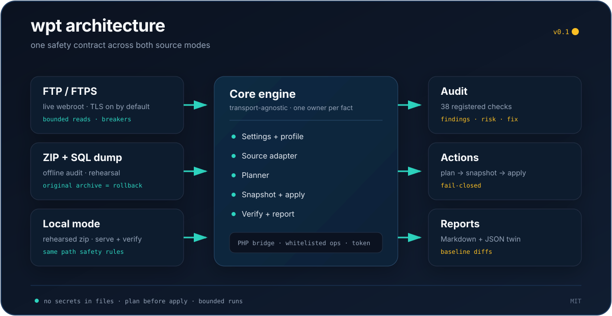

# Architecture

`wpt` separates the source of a site from the operations performed on it. The
same audit, clean, backup, and verify logic runs against a live FTP webroot or
an offline zip + SQL dump.

## Layers

- **CLI and settings.** `wpt.cli` parses commands and global options.
  `wpt.settings` loads the shipped profile and overlays `--profile`/`--set`.
  Every tunable has one owner in `wpt/data/profiles/default.json`.
- **Source adapters.** FTP/FTPS and zip adapters implement
  the same source contract. They own path validation, safe reads/writes,
  atomic replacement, and protected-file rules.
- **Core engine.** Discovery, planning, deadlines, logging, redaction,
  snapshots, reports, and the action/audit registries are independent of
  transport and persistence.
- **Actions and audit modules.** Capabilities register themselves; new behavior
  does not require editing a central switch. Audit checks report findings;
  actions produce plans and, on `--apply`, execute them.
- **Bridge.** For operations that need WordPress runtime knowledge, a temporary
  PHP file is uploaded and called through a whitelisted JSON protocol. It uses
  a short-lived token, `hash_equals`, an expiry, and a self-destruct request.
  The bridge exposes named operations only — no arbitrary SQL or PHP.
- **Reports.** Markdown for people and JSON for automation, generated from the
  same findings and plan items.

## Sources

### FTP / FTPS

The FTP source is for live sites. FTPS certificate and hostname verification
are on by default; a pre-migration opt-out is explicit and logs a warning.
Reads are bounded and parallelized with breaker protection. Writes use staged
siblings and renames where the server allows it.

### Zip + SQL dump

The local source treats a webroot zip as immutable input. A SQL dump is parsed
as a stream; it is never loaded whole into memory. Local actions stage changes
in an overlay and materialize a new archive, leaving the original as the
rollback.

### Local rehearsal

A rehearsed archive can be served and verified offline. The same protected-path
rules apply, so a local rehearsal cannot quietly edit `wp-config.php` or
WordPress core.

## Safety boundaries

- Path traversal, control characters, and symlink escapes are refused at the
  source boundary.
- `wp-config.php`, root `.htaccess`, `index.php`, `wp-admin`, and `wp-includes`
  are protected from ordinary writes and deletes.
- A write that needs an elevated permission uses an explicit, audited unlock.
- Snapshots are fail-closed: no snapshot, no apply.
- Credentials are read from the environment and redacted at the single logging
  choke point.

## Audit and actions

The audit registry exposes 38 checks across core integrity, security, database
health, media, performance, and configuration. Findings carry a category, a
risk, an estimated reclaimable size, and a suggested fix.

Actions are registry entries with an `applies` scope (local, FTP, or both).
Each action builds a plan; the executor applies it only after the gate. The
README command table and the action registry are checked against each other by
`tests/test_docs.py`.

## Tests

The suite is deliberately broad and deterministic:

- behavioral tests for command bodies and invariants;
- contract tests for the README, SPEC, profile, and packaging;
- integration tests for zip, SQL, FTP fakes, PHP bridge, and local serve;
- lifecycle tests for deadlines, cancellation, and shutdown;
- a public-safety scan that checks the working tree for credentials,
  public-looking IPs, non-example email/domain fixtures, local home paths,
  and generated or operational artifacts (a release backstop, not a full
  secret scanner).

Live FTP, SSH, and MySQL boundaries are represented by fakes in CI; live
validation is an operator step, not a test dependency.

## Further reading

- [R2 — bridge internals](research/R2.md)
- [R3 — WordPress update APIs](research/R3.md)
- [R4 — SQL dump streaming parser](research/R4.md)
- [SPEC.md](https://github.com/LLM-4-People/wp-toolkit/blob/main/SPEC.md)
